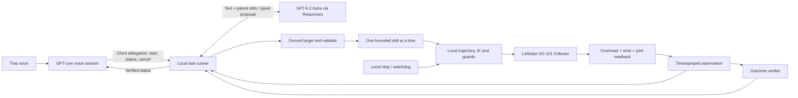

# Architecture v0.1

## Design decision

Use GPT-Live **client delegation** for speech, and a local orchestrator to call Astra via Responses with strict structured output. The app owns task IDs, permissions, fresh snapshot capture, cancellation, execution and feedback. GPT-Live can keep talking while the worker runs, but its conversation interruption is not itself robot cancellation. Speech stop/correction is a convenience; a local stop mechanism and supervised, physically clear workspace are required for hardware.



## Interfaces

| Component | Responsibility |
|---|---|
| voice_gateway | Browser microphone/speaker via GPT-Live. Convert delegated intent to start/status/cancel requests for the local runner, not motor calls. Preserve user language and report actual status. |
| observation | Paired camera frames with per-frame monotonic timestamps, measured joints, locally computed tip pose, calibration revision and scene/object IDs. Reject stale frames or excessive skew; capture a fresh pair after a motion checkpoint. |
| planner | Provide localized candidate IDs, two labelled still images, goal and last outcome to GPT-6.2 Astra. Parse strict schema and validate locally. Output a short subgoal plan, next skill/target and intended visual outcome; may ask, replan, or propose completion. No raw actuator tool or full trajectory in v0. |
| grounding | Stable overhead-to-base calibration and a measured tabletop plane, with a small local fiducial- or color-based tracker for v0. Wrist view checks close-up alignment/closure where visible. No guessed 3D depth from uncalibrated pixels. Workspace and objects allowlisted; on low confidence ask or stop. |
| executor | Read validated atomic requests only. Assign local approach / grasp / lift / place waypoints and orientations, not arbitrary 6D poses from cloud. A five-joint manipulation chain plus gripper cannot realize arbitrary position and orientation simultaneously. Use the calibrated SO-101 URDF, joint readback as IK seed, and an appropriate constrained orientation. LeRobot's Placo-based RobotKinematics and InverseKinematicsEEToJoints are candidate adapters; the SO101Follower handles observation and joint commands. Pin a LeRobot release and verify its API/units before writing integration. |
| guard / supervisor | Dry-run and replay default; optional later supervised hardware arm-enable. One in-flight skill. Check full interpolated path, workspace/keep-outs, table clearance, collisions detectable by the validated geometry, joint bounds, increments and tracking error. Timeout, disconnect, unsafe target or invalid telemetry: stop/hold as appropriate to the tested hardware and latch until operator re-arms. Never assume torque-off is a safe stop for an unsupported arm. |
| verifier | Distinguish physical motion completion from task success. Joint tracking can confirm arrival, not that an object was grasped. Check post-lift carry or final placement using fresh frames and local object tracking; report unknown if obscured. Astra can inspect evidence and ask for a better view, but cannot self-certify success. |

Example planner response, **not** a hardware command:

```json
{
  "task_id": "trial-007",
  "observation_id": "obs-014",
  "decision": "execute",
  "subgoals": ["move the referenced object to its destination"],
  "next_skill": "pick",
  "object_id": "obj-blue-01",
  "destination_id": null,
  "expected_outcome": "object is visibly above the tabletop and remains with gripper"
}
```

Other decisions: ask, report_blocked, propose_done. The runner independently validates expected result and plan applicability. Errors are typed: stale observation, invalid grounding, IK/path rejected, tracking timeout, grasp not verified, place not verified, canceled, stopped. A JSON parse success alone is not execution authorization.

## Task lifecycle and retry

IDLE → OBSERVE → PLAN → VALIDATE → EXECUTE → VERIFY → next skill / DONE / REPLAN. Report observed failure and fresh evidence upstream. For v0, per task: at most two **safe** replans after the first attempt, with a configurable total deadline (illustrative starting value 60 s) and request budget. Stop on unchanged state/repeated identical failure, unsafe reference, deadline or ambiguity; safety fault never auto-retries. On exhaustion return WAITING_FOR_USER and keep listening without moving. Cancel/correct invalidates the task generation, drops late responses and locks out queued motion; a new command starts only after stop is acknowledged. Local stop must not depend on cloud response, speech understanding, or the planner.

## Layout to implement, not modules already built

```text
src/soarm_astra/
  voice/                 # browser/backend GPT-Live gateway, no motor privileges
  planning/              # Astra Responses + schema
  observation/           # paired frames, state, grounding
  runtime/               # task IDs, async loop, budget, cancellation
  robot/                 # local skills, kinematics/motion, guards, adapters
  verification/          # grounded task predicates
evals/                   # preregistered held-out suite + replay fixtures
tests/                   # replay, stale reply, stop, invalid paths, fake hardware
```

## Milestones

1. **Replay:** text command + recorded/synthetic frame pairs + fake executor. Verify schema, state, retry cap, no false success, stop/cancel and stale response rejection. Log model ID, prompt version, time, usage and outcomes. Try more model reasoning on offline replay, not continuous polling or motor cadence.
2. **Voice with no motion:** live voice → text intent → planner → dry-run summary. Test Thai commands, variations, status and interruption. Keep keys server-side; do not commit credentials or raw recordings.
3. **Motor-disabled observation, then supervised primitive:** verify camera labels, pose calibration, joint mapping/readback, safe-stop behavior and workspace. Then operator-authorized small motions and one light-object pick/place test. Never auto-arm.
4. **Held-out demo:** run the preregistered trials, report successes and assistance, distinguish first-attempt and recovered successes.

## Fable baseline

The supplied friend artifact for `claude-control-arm` describes typed task, top + wrist JPEGs, measured joints, Fable tool calls (`look`, Cartesian waypoint moves, or raw-joint fallback), local LeRobot/IK and refreshed views after tools. It reports an actual Claude API call and an offline IK check, not a verified real-arm end-to-end run. Preserve the look–move–look loop and separation of reasoning from IK. Improve the termination criterion (silence does not equal success), remove raw-joint fallback, enforce local trajectory/speed safeguards and stop, and make retries and evidence observable. Fable is a design reference, not an API dependency.

## Sources

- [OpenAI GPT-Live and delegation](https://developers.openai.com/api/docs/guides/live)
- [GPT-6.2 Astra API model](https://developers.openai.com/api/docs/models/gpt-6.2-astra)
- [LeRobot action representations / SO-101 IK](https://huggingface.co/docs/lerobot/action_representations)
- [LeRobot phone teleop IK example](https://huggingface.co/docs/lerobot/main/en/phone_teleop)
